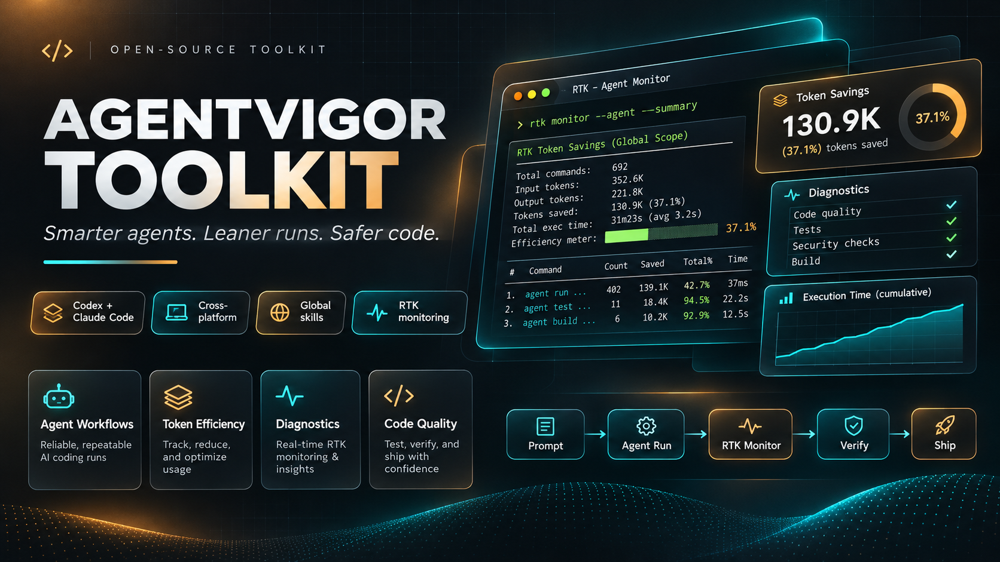
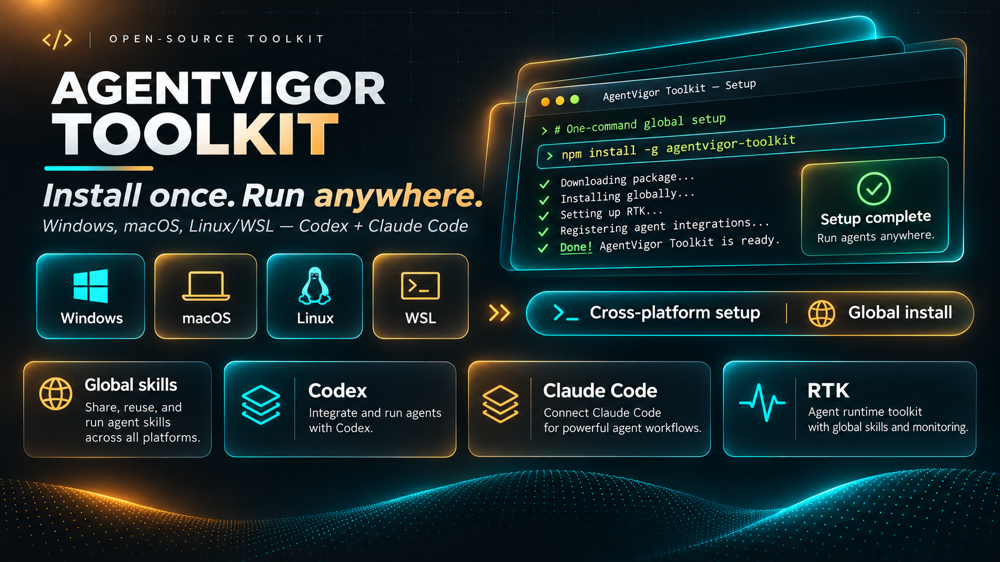
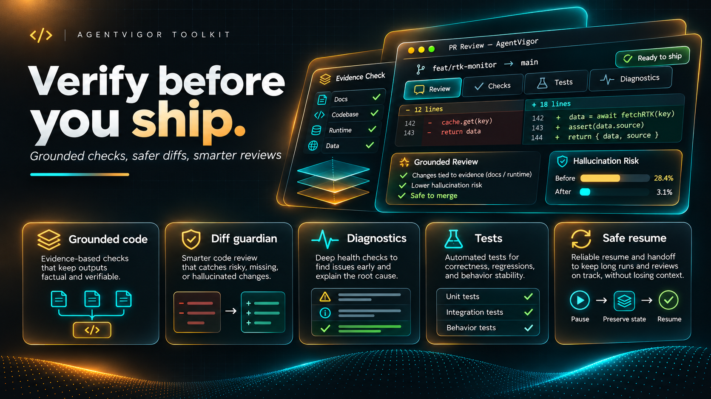
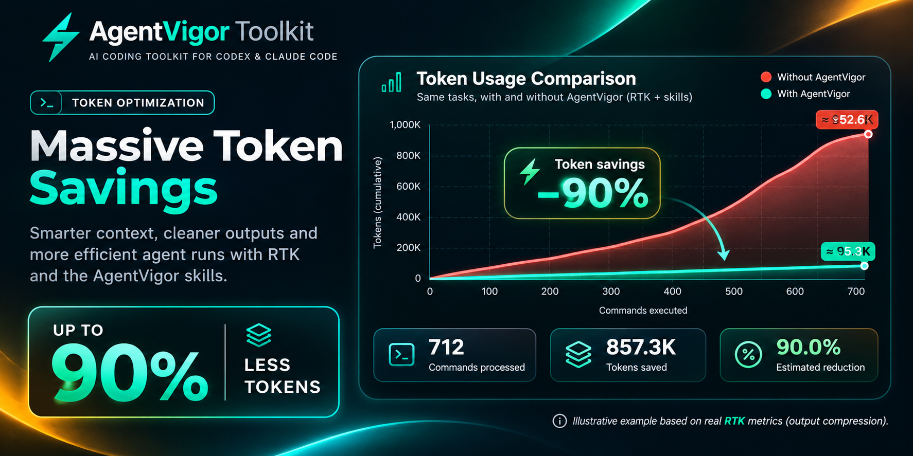

# AgentVigor Toolkit v1.0.0

Los procedimientos completos están disponibles offline con `agentvigor catalog --id development-environment-setup --mode full --lang es`. QUICK sigue como predeterminado. FULL conserva el idioma original y añade orientaciones localizadas. Consulta la [auditoría de paridad](docs/upstream-audit/PARITY.md) para ver evidencias y pendientes.

[English](README.md) · [Português brasileiro](README.pt-BR.md) · [Español](README.es.md)

**AgentVigor Toolkit v1.0.0 es estable para OpenAI Codex, el cliente principal con soporte.** Claude Code es una **integración experimental**: se conservan el instalador, las rutas de skills, las skills compatibles y los procedimientos QUICK/FULL, pero el descubrimiento y la ejecución nativos de Claude siguen **UNVERIFIED**. Las pruebas de Codex cubren los escenarios delimitados en el [registro de validación nativa](docs/NATIVE-CLIENT-VALIDATION.md); no implican comportamiento universal ni paridad completa con upstream. Consulta la [matriz de soporte y aceptación](docs/DELIVERY-STATUS.md), la [auditoría de paridad](docs/upstream-audit/PARITY.md) y la [guía de integración de Vibe](docs/es/VIBE-INTEGRATION.md).



> **Arte conceptual.** Los comandos de terminal, las comprobaciones, los tiempos y el ahorro del 37,1% de esta imagen son ilustrativos. Usa el comando documentado `agentvigor monitor` para consultar tus datos de RTK.

**Smarter agents. Leaner runs. Safer code.**

AgentVigor combina cinco skills originales con una skill que selecciona flujos bajo demanda, bases de proyecto, controles de calidad, un evaluador de harness y el monitor RTK. Codex es el cliente nativo estable; Claude Code sigue siendo experimental. El CLI usa funciones nativas de Node.js y funciona sin un servicio en segundo plano.

## Requisitos e instalación

Instala una revisión reciente de Node.js 22, 24 o 26 desde las [descargas oficiales](https://nodejs.org/en/download). La referencia es Node.js 24 LTS. Para la configuración estable con soporte, instala [OpenAI Codex](https://developers.openai.com/codex/cli/). Claude Code puede usar el adaptador experimental conservado; su comportamiento nativo no se homologó ni es equivalente al de Codex. RTK es opcional.



> **Arte conceptual.** Instala el paquete verificado `agentvigor-1.0.0.tgz` desde la [release de GitHub](https://github.com/TheRafaelSantos/AgentVigor-Toolkit/releases/tag/v1.0.0) con los comandos siguientes. El comando `npm install -g agentvigor-toolkit` y la configuración automática de RTK son ilustrativos. El paquete se distribuye mediante GitHub Releases, no por el registro npm. RTK significa Rust Token Killer.

### Windows · PowerShell

Abre PowerShell en la carpeta donde quieras clonar el proyecto. Ejecuta los comandos de abajo. En el Símbolo del sistema, usa `cd /d "AgentVigor Toolkit"` en lugar de `Set-Location`.

```powershell
git clone https://github.com/TheRafaelSantos/AgentVigor-Toolkit.git 'AgentVigor Toolkit'
Set-Location -LiteralPath 'AgentVigor Toolkit'
node bin/agentvigor.mjs --version
```

### macOS · Linux · WSL

Abre Terminal (o Ubuntu en WSL) en la carpeta donde quieras clonar el proyecto. En macOS, elige Node.js para tu arquitectura (`arm64` para Apple Silicon o `x64` para Intel). En WSL, usa Node.js y agentes de Linux dentro de la distribución. Windows y WSL usan carpetas de skills distintas.

```sh
git clone https://github.com/TheRafaelSantos/AgentVigor-Toolkit.git 'AgentVigor Toolkit'
cd 'AgentVigor Toolkit'
node bin/agentvigor.mjs --version
```

## Skills globales y perfiles

```text
node bin/agentvigor.mjs doctor
node bin/agentvigor.mjs install --agent codex --profile balanced --dry-run --lang es
node bin/agentvigor.mjs install --agent codex --profile balanced --lang es
node bin/agentvigor.mjs status
```

La vista previa enumera los cambios y no escribe archivos. El segundo comando pide confirmación antes de escribir. Usa `claude` para configurar Claude Code, `both` para ambos o `auto` para seleccionar los agentes detectados en PATH. La selección explícita admite clientes sin lanzador de terminal. El CLI avisa si falta el ejecutable en PATH.

Para automatizar, revisa la vista previa y añade `--yes`. Usa `--json` en instalación, actualización, reversión, estado o diagnóstico para obtener datos legibles por programas. Tras una instalación interactiva correcta, la respuesta predeterminada para abrir LinkedIn es no. CI y ejecuciones sin interacción omiten la pregunta.



> **Arte conceptual.** El diff, las comprobaciones correctas y los porcentajes de riesgo de alucinación son ilustrativos. AgentVigor ofrece flujos de revisión y handoff. Los resultados de pruebas requieren ejecución, y el handoff guardado ayuda a retomar en un runtime nuevo.

Todos los perfiles instalan la skill `agentvigor-toolkit`. `minimal` también incluye Grounded Code y Agent Doctor. `balanced`, el perfil predeterminado, añade Diff Guardian y Token Budget. `rigorous` incluye también Safe Resume. Puedes cambiar el perfil de un cliente sin modificar los archivos de skills del otro.

Codex busca skills personales en `~/.agents/skills`; el descubrimiento y la invocación nativos en escenarios delimitados forman parte de las evidencias estables de v1.0.0. Inicia una sesión nueva y escribe `$agentvigor-grounded-code`. Claude Code usa `~/.claude/skills` o `CLAUDE_CONFIG_DIR`. Se conservan su adaptador de instalación y las instrucciones compatibles, pero el descubrimiento y la invocación nativos siguen UNVERIFIED. Instalar archivos no equivale a homologar Claude ni a ofrecer el mismo nivel de soporte que Codex.

### Instalar el CLI global desde GitHub Releases

Descarga `agentvigor-1.0.0.tgz` y `SHA256SUMS.txt` desde la [release v1.0.0](https://github.com/TheRafaelSantos/AgentVigor-Toolkit/releases/tag/v1.0.0). Compara el SHA-256 del paquete con la línea correspondiente antes de instalar. En PowerShell usa `npm.cmd`; macOS/Linux usan `npm`. El prefijo global de npm debe permitir escritura y estar en PATH.

```text
npm install --global --offline --ignore-scripts ./agentvigor-1.0.0.tgz
agentvigor --version
agentvigor doctor
agentvigor install --agent codex --profile balanced --dry-run --lang es
```

En Windows PowerShell, sustituye `npm` por `npm.cmd` y usa
`.\agentvigor-1.0.0.tgz` como ruta del paquete.

## Flujos de Vibe y configuración de proyectos

Usa `catalog` para elegir un flujo y previsualizar la adopción en el directorio del proyecto. Los archivos existentes reciben propuestas en `.agentvigor-project/proposals/`. Para ejecutar controles, revisa `agentvigor.quality.json`. La guía cubre una base Next.js, ESLint, el ejercicio desechable de harness y la reversión del proyecto.

```text
agentvigor catalog --lang es
agentvigor project --mode adopt --template docs --path . --dry-run
agentvigor quality --path . --dry-run
```

## Diagnóstico y monitor de RTK

`doctor` detecta la plataforma, ejecutables, RTK y entradas duplicadas en los archivos JSON globales de hooks que comprueba. El estado de los archivos y el descubrimiento por parte del cliente se verifican por separado. La guía de integraciones detalla los límites. Tras instalar RTK desde su fuente oficial, ejecuta `monitor` en la terminal. El intervalo predeterminado es de 60 segundos. `--once` realiza una lectura y `--no-clear` conserva el historial. Pulsa Ctrl+C para salir. El monitor conserva las métricas y avisos de RTK. RTK puede inicializar o migrar su propia base SQLite al consultarla.

```text
node bin/agentvigor.mjs doctor
node bin/agentvigor.mjs monitor --once
node bin/agentvigor.mjs monitor --interval 30 --no-clear
```

## Seguridad, actualizaciones y desinstalación

El instalador gestiona solo los archivos `SKILL.md` de AgentVigor y el estado privado en `~/.agentvigor`, donde guarda las copias de recuperación. Ante conflictos o cambios manuales, se detiene. `update` vuelve a aplicar las skills de la versión local. Para cambiar de versión, instala primero el paquete verificado de GitHub Releases y ejecuta `update`. `rollback` restaura el cambio gestionado anterior. `rollback --all` elimina los archivos de skills gestionados. Revisa la vista previa antes de confirmar.

```text
node bin/agentvigor.mjs update --dry-run
node bin/agentvigor.mjs update
node bin/agentvigor.mjs rollback --dry-run
node bin/agentvigor.mjs rollback --all --dry-run
node bin/agentvigor.mjs rollback --all
```

Después de eliminar las skills, ejecuta `npm uninstall --global agentvigor` si instalaste el CLI mediante npm. Para recuperar una operación interrumpida, consulta la guía de recuperación. Los plugins, hooks y herramientas externas tienen sus propios procedimientos de instalación y retirada.

## Benchmarks y telemetría



> **Métricas ilustrativas.** El 90% y las cifras del gráfico son ejemplos de la ilustración sin validación por un benchmark de AgentVigor. Usa el laboratorio de ejecuciones emparejadas para medir tus resultados. Las estimaciones de RTK describen la compresión de la salida de comandos.

Compara observaciones emparejadas con `agentvigor benchmark --input observations.json`. El laboratorio explica cómo medir. RTK estima el ahorro en la salida de comandos. El uso de tokens del proveedor, la facturación y los límites de la suscripción se miden por separado. La telemetría está desactivada de forma predeterminada. La activación se limita a una ejecución y requiere un recolector HTTPS configurado por el operador. El proyecto no aloja un recolector.

## Guías y contribuciones

- [Integraciones](docs/INTEGRATIONS.md)
- [Instalación gestionada y reversión](docs/INTEGRATION-MANAGEMENT.md)
- [Preset opcional de Next.js y PostgreSQL](docs/NEXT-POSTGRES-PRESET.md#español)
- [Recuperación](docs/RECOVERY.md)
- [Laboratorio de benchmark](docs/BENCHMARK.md)
- [Telemetría](docs/TELEMETRY.md)
- [Desarrollo](docs/DEVELOPMENT.md)
- [Cómo contribuir](CONTRIBUTING.md)
- [Avisos de terceros](THIRD_PARTY_NOTICES.md)
- [Política de seguridad](SECURITY.md)
- [Soporte de clientes y aceptación](docs/DELIVERY-STATUS.md)
- [Changelog](CHANGELOG.md)

## Creado y mantenido por Rafael Pereira

AgentVigor Toolkit es un proyecto independiente de código abierto. La implementación original usa la licencia MIT. Los avisos acreditan a los proyectos externos y a Matheus Gomes por la referencia técnica.

[GitHub](https://github.com/TheRafaelSantos) · [LinkedIn](https://www.linkedin.com/in/gerente-de-ecommerce/) · [MIT](LICENSE)
