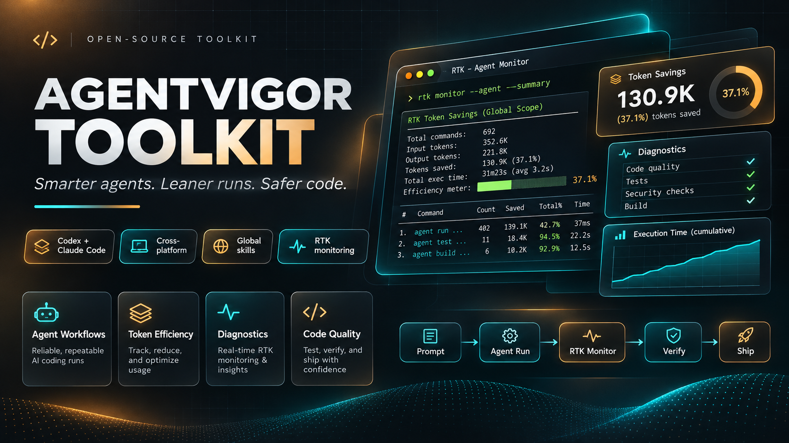
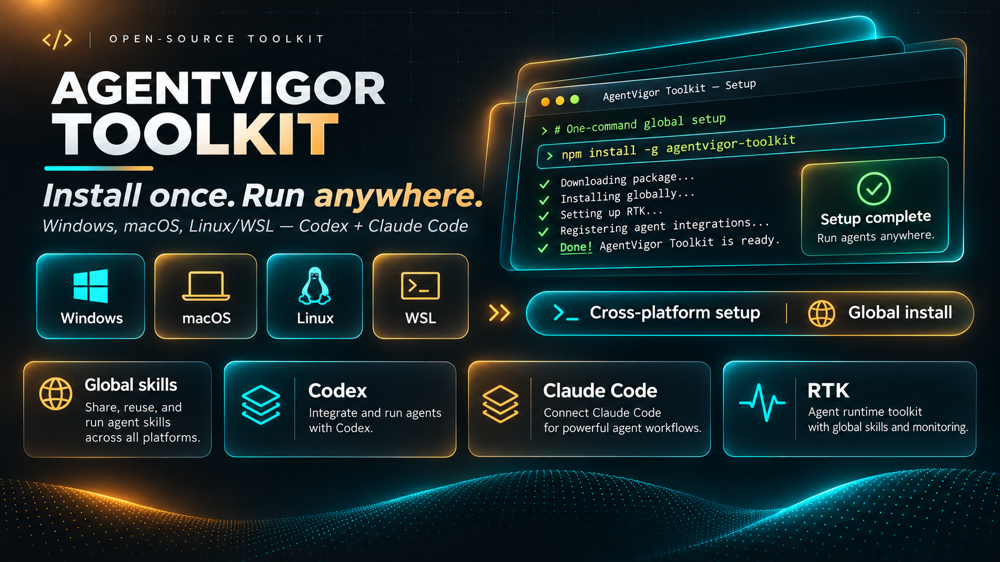
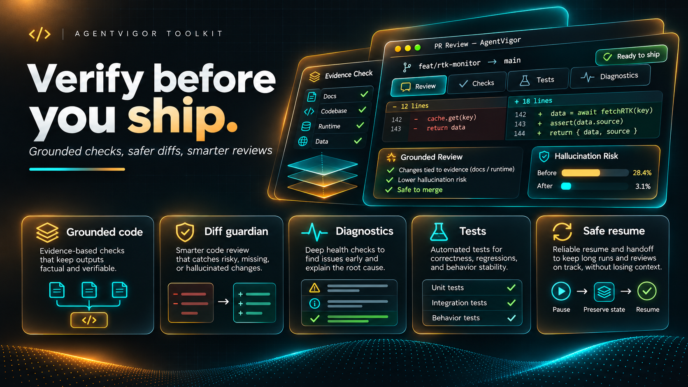
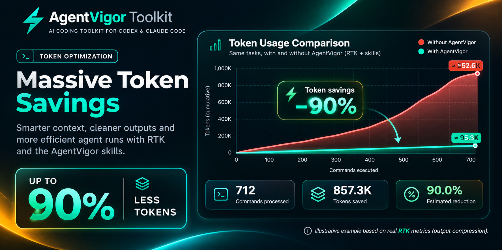

# AgentVigor Toolkit

[English](README.md) · [Português brasileiro](README.pt-BR.md) · [Español](README.es.md)

Release candidate `0.1.0-rc.1`. See the [validation record](docs/RELEASE-CANDIDATE.md) for implemented milestones, verified environments and remaining client acceptance checks.



> **Concept artwork.** The terminal commands, checks, times and 37.1% savings in this image are illustrative. Use the documented `agentvigor monitor` command to view your own RTK data.

**Smarter agents. Leaner runs. Safer code.**

AgentVigor is a local toolkit for OpenAI Codex and Claude Code. It installs five original skills on demand, checks the local agent setup, and displays RTK command-output statistics. The CLI uses Node.js built-ins and has no background service.

## Requirements and installation

Install a current patch of Node.js 22, 24 or 26 from the [official downloads](https://nodejs.org/en/download), plus Git if you use the source checkout. Node.js 24 LTS is the reference. Install at least one client using the [Codex instructions](https://developers.openai.com/codex/cli/) or the [Claude Code setup guide](https://code.claude.com/docs/en/setup). RTK is optional.



> **Concept artwork.** Install from this repository or a verified release tarball using the commands below. The image's `npm install -g agentvigor-toolkit` and automatic RTK setup are illustrative. The package has not been published to the npm registry. RTK means Rust Token Killer.

### Windows · PowerShell

Open PowerShell in the folder where you want the checkout. Run the commands below. In Command Prompt, use `cd /d "AgentVigor Toolkit"` in place of `Set-Location`.

```powershell
git clone https://github.com/TheRafaelSantos/AgentVigor-Toolkit.git 'AgentVigor Toolkit'
Set-Location -LiteralPath 'AgentVigor Toolkit'
node bin/agentvigor.mjs --version
```

### macOS · Linux · WSL

Open Terminal (or Ubuntu in WSL) in the folder where you want the checkout. On macOS, use the Node.js build for your architecture (`arm64` for Apple Silicon or `x64` for Intel). In WSL, use Linux Node.js and Linux agents inside the distribution. Windows and WSL have separate user skill directories.

```sh
git clone https://github.com/TheRafaelSantos/AgentVigor-Toolkit.git 'AgentVigor Toolkit'
cd 'AgentVigor Toolkit'
node bin/agentvigor.mjs --version
```

## Global skills and profiles

```text
node bin/agentvigor.mjs install --agent codex --dry-run --lang en
node bin/agentvigor.mjs install --agent codex --lang en
node bin/agentvigor.mjs status
```

The preview lists the exact managed changes and writes nothing. The second command asks for confirmation before writing. Select `claude` to configure Claude Code, `both` to configure both clients, or `auto` to select the agents detected on PATH. Explicit selection also supports a client installed without a shell launcher. The CLI warns when a selected executable is absent from PATH.

For automation, review the dry run and pass `--yes`. Add `--json` to installation, update, rollback, status or doctor for machine-readable output. After a successful interactive install, the LinkedIn prompt defaults to no. CI and unattended runs skip it.



> **Concept artwork.** The diff, passing checks and hallucination-risk percentages are illustrative. AgentVigor provides review and handoff workflows. Actual test results require execution, and a saved handoff supports resuming in a new runtime.

`minimal` installs Grounded Code and Agent Doctor. `balanced` adds Diff Guardian and Token Budget and is the default. `rigorous` also includes Safe Resume. An explicitly selected client can be reconfigured without changing the other client's skill files.

Codex discovers user skills in `~/.agents/skills`. Start a new Codex session and type `$agentvigor-grounded-code` to find the skill. Claude Code uses `~/.claude/skills` or the configured `CLAUDE_CONFIG_DIR`. Restart Claude Code, open its slash menu and look for `/agentvigor-grounded-code`. `status` verifies managed files on disk. The client's selector verifies discovery. Skills load on demand and selection depends on the task and client policy.

### Optional global CLI from a local tarball

Inside the checkout, run the commands below. Use `npm.cmd` in Windows PowerShell if `npm.ps1` is blocked. An npm global prefix writable by your account must be on PATH. Reopen the terminal if `agentvigor` is missing. A GitHub pre-release tarball, when available, is equivalent to the file produced by `npm pack`. Verify the accompanying SHA-256 before installing.

```text
npm pack --ignore-scripts
npm install --global --offline --ignore-scripts ./agentvigor-0.1.0-rc.1.tgz
agentvigor --version
agentvigor --help
```

## Diagnosis and RTK monitor

`doctor` checks platform, executable discovery, RTK and duplicate entries in the supported global JSON hook files. It reports skill-file health separately from client discovery. See the integration guide for scopes it cannot inspect. After installing RTK from its official source, use `monitor` in the foreground. The default interval is 60 seconds. `--once` performs one refresh and `--no-clear` preserves terminal history. Press Ctrl+C to stop. The monitor displays RTK's metrics and warnings. RTK can initialize or migrate its own SQLite store when reading it.

```text
node bin/agentvigor.mjs doctor
node bin/agentvigor.mjs monitor --once
node bin/agentvigor.mjs monitor --interval 30 --no-clear
```

## Security, updates and removal

Only AgentVigor's own `SKILL.md` files and private state in `~/.agentvigor` are managed. Keep that directory intact as it holds recovery snapshots. The installer stops on conflicts or manual edits. `update` reapplies the skills from the current local CLI. For a newer release, check out its reviewed tag or install its verified tarball first, then run the update. `rollback` restores the previous managed change. `rollback --all` removes managed skill files. Preview either operation before confirming.

```text
node bin/agentvigor.mjs update --dry-run
node bin/agentvigor.mjs update
node bin/agentvigor.mjs rollback --dry-run
node bin/agentvigor.mjs rollback --all --dry-run
node bin/agentvigor.mjs rollback --all
```

After removing the skills, run `npm uninstall --global agentvigor` if you installed the CLI via npm. For rollback after a stopped process, follow the recovery guide. Plugins, hooks and third-party tools follow their own installation and removal procedures.

## Benchmarks and telemetry



> **Illustrative metrics.** The 90% claim and numerical graph in this artwork are unverified examples supplied with the design. No AgentVigor benchmark has established those savings. Run the paired benchmark lab to measure your own results. RTK output-token estimates describe command-output compression.

Compare observations from paired runs with `agentvigor benchmark --input observations.json`. The benchmark lab explains how to gather measurements. RTK estimates command-output savings. Provider token usage, bills and subscription limits use separate measurements. Telemetry is off by default. A one-time opt-in requires a user-configured HTTPS collector, and this project hosts none.

## Guides and contribution

- [Integrations](docs/INTEGRATIONS.md)
- [Recovery](docs/RECOVERY.md)
- [Benchmark lab](docs/BENCHMARK.md)
- [Telemetry](docs/TELEMETRY.md)
- [Development](docs/DEVELOPMENT.md)
- [Contributing](CONTRIBUTING.md)
- [Third-party notices](THIRD_PARTY_NOTICES.md)
- [Changelog](CHANGELOG.md)

## Created and maintained by Rafael Pereira

AgentVigor Toolkit is an independent open-source project. The original implementation is released under MIT. The notices credit upstream projects and the technical reference by Matheus Gomes.

[GitHub](https://github.com/TheRafaelSantos) · [LinkedIn](https://www.linkedin.com/in/gerente-de-ecommerce/) · [MIT](LICENSE)
