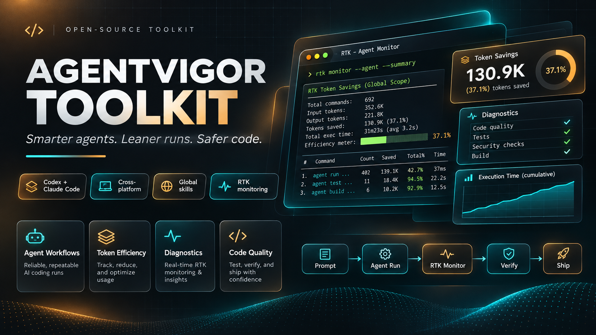
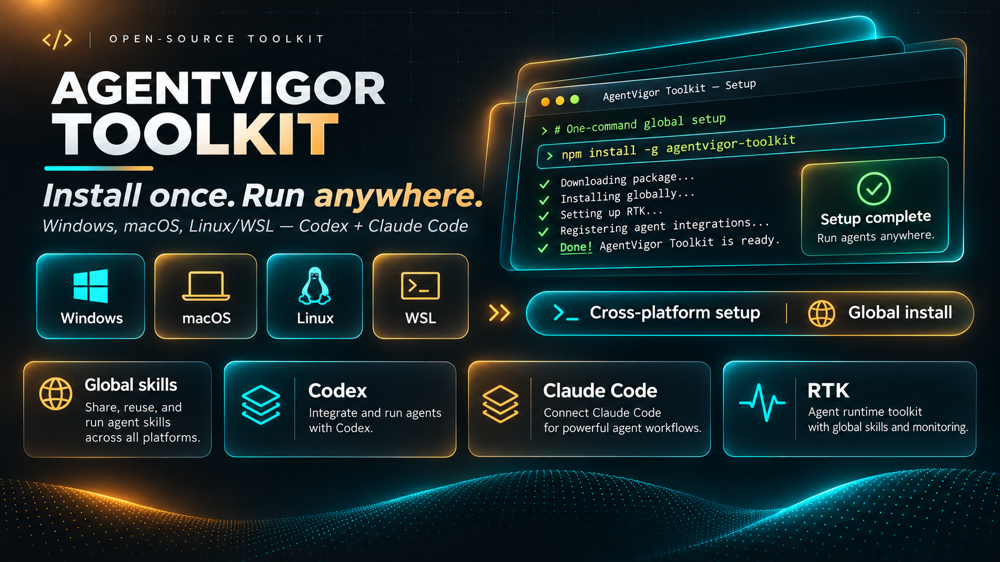
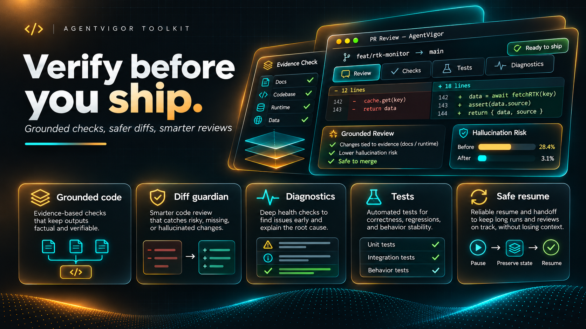
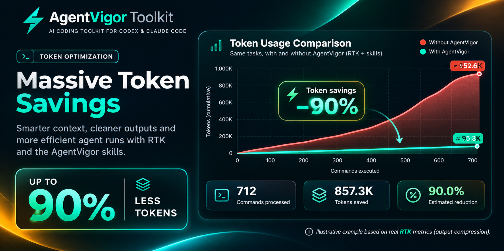

# AgentVigor Toolkit

Os procedimentos detalhados estão disponíveis offline com `agentvigor catalog --id development-environment-setup --mode full --lang pt-BR`. QUICK continua como padrão. FULL preserva o idioma original da fonte e acrescenta orientações localizadas. Consulte a [auditoria de paridade](docs/upstream-audit/PARITY.md) para ver as evidências e pendências.

[English](README.md) · [Português brasileiro](README.pt-BR.md) · [Español](README.es.md)

O candidato `0.3.0-rc.1` inclui fluxos QUICK/FULL completos offline e integrações opcionais gerenciadas. Consulte o [guia de integração com o Vibe](docs/pt-BR/VIBE-INTEGRATION.md), a [matriz de paridade](docs/upstream-audit/PARITY.md) e a [validação e limitações do candidato](docs/CANDIDATE-0.3.md#português-brasileiro).



> **Arte conceitual.** Os comandos de terminal, checks, tempos e a economia de 37,1% desta imagem são ilustrativos. Use o comando documentado `agentvigor monitor` para consultar os seus dados reais do RTK.

**Smarter agents. Leaner runs. Safer code.**

O AgentVigor combina cinco skills autorais com uma skill que seleciona fluxos sob demanda, bases de projeto, controles de qualidade, um avaliador de harness e o monitor RTK para Codex e Claude Code. O CLI usa recursos nativos do Node.js e funciona sem serviço em segundo plano.

## Requisitos e instalação

Instale uma atualização recente do Node.js 22, 24 ou 26 pelos [downloads oficiais](https://nodejs.org/en/download). A versão de referência é o Node.js 24 LTS. Instale Git para usar o checkout e pelo menos um agente pelas [instruções do Codex](https://developers.openai.com/codex/cli/) ou pelo [guia do Claude Code](https://code.claude.com/docs/en/setup). O RTK é opcional.



> **Arte conceitual.** Instale pelo repositório ou por um pacote de release verificado seguindo os comandos abaixo. O comando `npm install -g agentvigor-toolkit` e a configuração automática do RTK na imagem são ilustrativos. O pacote ainda não foi publicado no registro npm. RTK significa Rust Token Killer.

### Windows · PowerShell

Abra o PowerShell na pasta onde quer clonar o projeto. Execute os comandos abaixo. No Prompt de Comando, use `cd /d "AgentVigor Toolkit"` no lugar de `Set-Location`.

```powershell
git clone https://github.com/TheRafaelSantos/AgentVigor-Toolkit.git 'AgentVigor Toolkit'
Set-Location -LiteralPath 'AgentVigor Toolkit'
node bin/agentvigor.mjs --version
```

### macOS · Linux · WSL

Abra o Terminal (ou o Ubuntu no WSL) na pasta onde quer clonar o projeto. No macOS, escolha o Node.js para sua arquitetura (`arm64` no Apple Silicon ou `x64` no Intel). No WSL, use o Node.js e os agentes de Linux dentro da distribuição. Windows e WSL usam diretórios de skills separados.

```sh
git clone https://github.com/TheRafaelSantos/AgentVigor-Toolkit.git 'AgentVigor Toolkit'
cd 'AgentVigor Toolkit'
node bin/agentvigor.mjs --version
```

## Skills globais e perfis

```text
node bin/agentvigor.mjs install --agent codex --dry-run --lang pt-BR
node bin/agentvigor.mjs install --agent codex --lang pt-BR
node bin/agentvigor.mjs status
```

A prévia lista as alterações gerenciadas e roda sem gravar arquivos. O segundo comando pede confirmação antes de gravar. Use `claude` para configurar o Claude Code, `both` para os dois ou `auto` para selecionar os agentes detectados no PATH. A seleção explícita também permite configurar um cliente instalado sem comando de terminal. Nesse caso o CLI avisa que o executável está ausente do PATH.

Em automações, revise a prévia e passe `--yes`. Use `--json` em instalação, atualização, reversão, status ou diagnóstico para ler a saída por programa. Após uma instalação interativa bem-sucedida, o convite para abrir o LinkedIn tem resposta padrão negativa. CI e execuções sem interação pulam a pergunta.



> **Arte conceitual.** O diff, os checks aprovados e os percentuais de risco de alucinação são ilustrativos. O AgentVigor oferece fluxos de revisão e handoff. Resultados de testes exigem execução, e o handoff salvo auxilia a retomada em um novo runtime.

Todos os perfis instalam a skill `agentvigor-toolkit`. O `minimal` inclui também Grounded Code e Agent Doctor. `balanced`, o padrão, acrescenta Diff Guardian e Token Budget. `rigorous` inclui também Safe Resume. Você pode mudar o perfil de um cliente sem alterar os arquivos de skills do outro.

O Codex procura skills pessoais em `~/.agents/skills`. Abra uma nova sessão e digite `$agentvigor-grounded-code` para encontrar a skill. O Claude Code usa `~/.claude/skills` ou o caminho definido em `CLAUDE_CONFIG_DIR`. Reinicie o Claude Code, abra o menu de comandos com `/` e procure `/agentvigor-grounded-code`. `status` verifica os arquivos no disco. O seletor do cliente confirma a descoberta. As skills carregam sob demanda conforme a tarefa e a política do cliente.

### CLI global opcional por pacote local

Execute os comandos abaixo dentro do checkout. No PowerShell, use `npm.cmd` se `npm.ps1` estiver bloqueado. Use um prefixo global do npm gravável pela sua conta e presente no PATH. Se `agentvigor` estiver ausente, reabra o terminal. O pacote `.tgz` do pré-release, quando disponível, equivale ao arquivo de `npm pack`. Compare o SHA-256 publicado antes de instalar.

```text
npm pack --ignore-scripts
npm install --global --offline --ignore-scripts ./agentvigor-0.3.0-rc.1.tgz
agentvigor --version
agentvigor --help
```

## Fluxos do Vibe e configuração de projetos

Use `catalog` para escolher um fluxo e visualize a adoção na pasta do projeto. Para arquivos existentes, as propostas ficam em `.agentvigor-project/proposals/`. A execução dos checks requer revisão do `agentvigor.quality.json`. O guia de integração cobre a base Next.js, o ESLint, o exercício descartável de harness e o rollback de projeto.

```text
agentvigor catalog --lang pt-BR
agentvigor project --mode adopt --template docs --path . --dry-run
agentvigor quality --path . --dry-run
```

## Diagnóstico e monitor do RTK

`doctor` identifica a plataforma, executáveis, RTK e entradas repetidas nos arquivos JSON globais de hooks que a ferramenta verifica. A integridade dos arquivos e a descoberta pelo agente são verificações separadas. O guia de integrações detalha os limites. Após instalar o RTK da fonte oficial, use `monitor` no terminal. O intervalo padrão é de 60 segundos. `--once` faz uma leitura e `--no-clear` preserva o histórico do terminal. Pressione Ctrl+C para encerrar. O monitor exibe métricas e avisos do RTK. O RTK pode inicializar ou migrar seu próprio banco SQLite durante a leitura.

```text
node bin/agentvigor.mjs doctor
node bin/agentvigor.mjs monitor --once
node bin/agentvigor.mjs monitor --interval 30 --no-clear
```

## Segurança, atualização e desinstalação

O instalador gerencia apenas os arquivos `SKILL.md` do AgentVigor e o estado privado em `~/.agentvigor`, onde ficam as cópias de recuperação. Em caso de conflito ou alteração manual, ele para. `update` reaplica as skills da versão local do CLI. Para atualizar a versão, faça checkout da tag revisada ou instale o novo pacote verificado e depois rode `update`. `rollback` restaura a alteração anterior. `rollback --all` remove os arquivos de skills gerenciados. Revise a prévia antes de confirmar.

```text
node bin/agentvigor.mjs update --dry-run
node bin/agentvigor.mjs update
node bin/agentvigor.mjs rollback --dry-run
node bin/agentvigor.mjs rollback --all --dry-run
node bin/agentvigor.mjs rollback --all
```

Depois de remover as skills, execute `npm uninstall --global agentvigor` se instalou o CLI via npm. Em caso de processo interrompido, siga o guia de recuperação. Plugins, hooks e ferramentas de terceiros têm seus próprios procedimentos de instalação e remoção.

## Benchmarks e telemetria



> **Métricas ilustrativas.** O percentual de 90% e os números do gráfico são exemplos fornecidos na arte, sem comprovação por benchmark do AgentVigor. Use o laboratório de execuções pareadas para medir seus resultados. As estimativas do RTK se referem à compressão das saídas de comandos.

Compare medições de execuções pareadas com `agentvigor benchmark --input observations.json`. O laboratório explica como coletar os dados. O RTK estima a economia nas saídas de comandos. Uso de tokens do provedor, cobrança e limites de assinatura são medidas distintas. A telemetria fica desligada por padrão. O consentimento vale para uma execução e exige um coletor HTTPS configurado pelo operador. O projeto não hospeda um coletor.

## Guias e contribuições

- [Integrações](docs/INTEGRATIONS.md)
- [Instalação gerenciada e reversão](docs/INTEGRATION-MANAGEMENT.md)
- [Recuperação](docs/RECOVERY.md)
- [Laboratório de benchmark](docs/BENCHMARK.md)
- [Telemetria](docs/TELEMETRY.md)
- [Desenvolvimento](docs/DEVELOPMENT.md)
- [Como contribuir](CONTRIBUTING.md)
- [Avisos de terceiros](THIRD_PARTY_NOTICES.md)
- [Changelog](CHANGELOG.md)

## Criado e mantido por Rafael Pereira

O AgentVigor Toolkit é um projeto open source independente. A implementação original usa a licença MIT. Os avisos registram os créditos a projetos externos e à referência técnica de Matheus Gomes.

[GitHub](https://github.com/TheRafaelSantos) · [LinkedIn](https://www.linkedin.com/in/gerente-de-ecommerce/) · [MIT](LICENSE)
